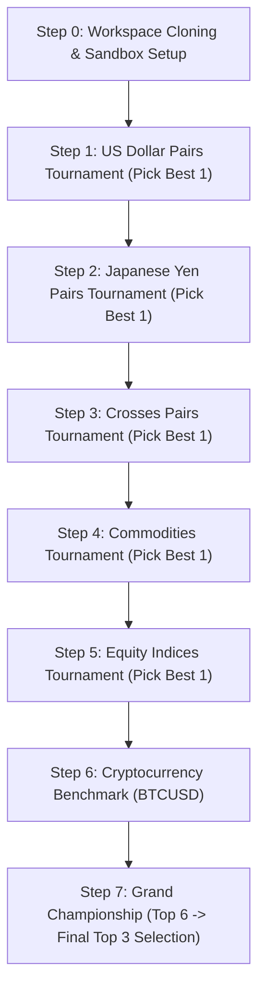

# Multi-Asset Screening & Walk-Forward Tournament Guide
## Systematic Instrument Selection for Autonomous Agentic AI Trading System

This document outlines the step-by-step tournament methodology to rigorously test and select the **Top 3 Instruments** across 6 distinct asset classes for deployment in the Autonomous Agentic AI Trading System.

---

### Tournament Specifications & Safeguards

- **Asset Universe (18 Instruments across 6 Asset Classes)**:
  1. **US Dollar Pairs**: `EURUSD`, `GBPUSD`, `USDCAD`, `AUDUSD`, `NZDUSD`
  2. **Japanese Yen Pairs**: `USDJPY`, `EURJPY`, `GBPJPY`, `CADJPY`, `AUDJPY`
  3. **Crosses Pairs**: `EURAUD`, `EURGBP`, `GBPAUD`
  4. **Commodities**: `USOilCash`, `GOLD`
  5. **Equity Indices**: `US500Cash`, `US30Cash`, `US100Cash`, `GER40Cash`, `UK100Cash`, `JP225Cash`
  6. **Cryptocurrency**: `BTCUSD`

- **Execution Testing Pipeline**:
  - **Phase 1: In-Sample Backtest & Screening**:
    - **Date Range**: January 1, 2021 to June 30, 2024
    - **Modelling**: 1-Minute OHLC (`M1 OHLC`) for fast, robust structural screening
    - **Minimum Bar Criteria**: Profit Factor $\ge 1.35$, Max Drawdown $< 7.0\%$, Trade Count $\ge 120$
  - **Phase 2: Out-of-Sample Walk-Forward Validation**:
    - **Date Range**: July 1, 2024 to Present Date
    - **Modelling**: Every tick based on **real ticks** (exact bid/ask tick replay)
    - **Latency**: Measured live broker latency to XM Global server
    - **Pass Criteria**: Out-of-sample Sharpe $\ge 1.5$, Out-of-sample Max Drawdown $< 6.5\%$
  - **Phase 3: 10,000-Step Monte Carlo Audit**:
    - Risk of Ruin $< 1.0\%$, 95th-Percentile DD $< 8.0\%$

- **Duplication & Workspace Isolation**:
  - To preserve the pristine original project workspace, all tests and benchmark runs execute in a designated sandbox workspace:
    `C:\Users\zulle\My Drive\FOREX\Trading System Sandbox Tournament`

---

## Tournament Step-by-Step Execution Plan



---

## Detailed Step Prompts for Antigravity IDE

### STEP 0: Workspace Cloning & Sandbox Setup
Run this prompt first in Antigravity IDE to clone your core trading system into the duplicate tournament workspace.

```text
/plan /goal
Set up an isolated testing sandbox to evaluate 18 candidate instruments across 6 asset classes.

1. Create a clean duplicate workspace directory at:
   "C:\Users\zulle\My Drive\FOREX\Trading System Sandbox Tournament"

2. Copy all files from:
   "C:\Users\zulle\My Drive\FOREX\Autonomous Agentic AI Trading System"
   into the new sandbox directory, excluding git or temp files.

3. Verify that all components exist in the duplicate workspace:
   - config/system_config.json & config/parameters/*.json
   - src/mql5/Include, src/mql5/Indicators, src/mql5/Experts
   - src/agents/ & src/utils/
   - tests/ & main.py

4. Connect to MetaTrader 5 via MCP:
   - Terminal Path: "C:\Program Files\XM Global MT5 1\terminal64.exe"
   - Confirm terminal connection and measure live ping/latency to broker.
   - Compile all 3 EAs and the MarketRegimeIdentifier indicator. Ensure zero compilation errors.

Report confirmation once the sandbox environment is ready for Step 1.
```

---

### STEP 1: Asset Class 1 — US Dollar Pairs Tournament
Candidates: `EURUSD`, `GBPUSD`, `USDCAD`, `AUDUSD`, `NZDUSD`

```text
/plan /goal
Run Asset Class 1 Tournament: US Dollar Pairs (EURUSD, GBPUSD, USDCAD, AUDUSD, NZDUSD)
Working Directory: "C:\Users\zulle\My Drive\FOREX\Trading System Sandbox Tournament"
MT5 Terminal: "C:\Program Files\XM Global MT5 1\terminal64.exe"

For EACH instrument in [EURUSD, GBPUSD, USDCAD, AUDUSD, NZDUSD], sequentially execute:

1. IN-SAMPLE BACKTEST (Jan 1, 2021 – Jun 30, 2024):
   - Model: 1-Minute OHLC.
   - Run the system with MarketRegimeIdentifier and the 3 Execution EAs.
   - Record: Net Profit, Profit Factor (PF), Max Drawdown (DD%), Total Trades, Win Rate, Expectancy.

2. OUT-OF-SAMPLE WALK-FORWARD TEST (Jul 1, 2024 – Present):
   - Model: Every tick based on REAL ticks.
   - Execution Latency: Use measured broker ping.
   - Record: Out-of-Sample Profit, Out-of-Sample PF, Out-of-Sample Max DD%, Sharpe Ratio.

3. MONTE CARLO 10,000-STEP AUDIT:
   - Run monte_carlo.py on the Walk-Forward trade series.
   - Record: Risk of Ruin %, 95th Percentile Max DD%.

4. CLASS WINNER SELECTION:
   - Score and rank all 5 USD pairs using Composite Score = (Sharpe * 0.4) + (PF * 0.3) - (Max_DD% * 0.3).
   - Save the full comparative results table to:
     "docs/tournament/asset_class_1_usd_pairs.md"
   - Declare the #1 winning USD instrument.
```

---

### STEP 2: Asset Class 2 — Japanese Yen Pairs Tournament
Candidates: `USDJPY`, `EURJPY`, `GBPJPY`, `CADJPY`, `AUDJPY`

```text
/plan /goal
Run Asset Class 2 Tournament: Japanese Yen Pairs (USDJPY, EURJPY, GBPJPY, CADJPY, AUDJPY)
Working Directory: "C:\Users\zulle\My Drive\FOREX\Trading System Sandbox Tournament"
MT5 Terminal: "C:\Program Files\XM Global MT5 1\terminal64.exe"

For EACH instrument in [USDJPY, EURJPY, GBPJPY, CADJPY, AUDJPY], sequentially execute:

1. IN-SAMPLE BACKTEST (Jan 1, 2021 – Jun 30, 2024):
   - Model: 1-Minute OHLC.
   - Run the system with MarketRegimeIdentifier and the 3 Execution EAs.
   - Record: Net Profit, Profit Factor, Max Drawdown %, Total Trades, Expectancy.

2. OUT-OF-SAMPLE WALK-FORWARD TEST (Jul 1, 2024 – Present):
   - Model: Every tick based on REAL ticks.
   - Execution Latency: Live measured broker ping.
   - Record: Out-of-Sample Net Profit, Out-of-Sample PF, Out-of-Sample Max DD%, Sharpe Ratio.

3. MONTE CARLO 10,000-STEP AUDIT:
   - Run monte_carlo.py on the Walk-Forward trades.
   - Check Risk of Ruin % and 95th Percentile DD%.

4. CLASS WINNER SELECTION:
   - Score and rank the 5 JPY pairs.
   - Output comparison markdown to:
     "docs/tournament/asset_class_2_jpy_pairs.md"
   - Declare the #1 winning JPY instrument.
```

---

### STEP 3: Asset Class 3 — Crosses Pairs Tournament
Candidates: `EURAUD`, `EURGBP`, `GBPAUD`

```text
/plan /goal
Run Asset Class 3 Tournament: Crosses Pairs (EURAUD, EURGBP, GBPAUD)
Working Directory: "C:\Users\zulle\My Drive\FOREX\Trading System Sandbox Tournament"
MT5 Terminal: "C:\Program Files\XM Global MT5 1\terminal64.exe"

For EACH instrument in [EURAUD, EURGBP, GBPAUD], sequentially execute:

1. IN-SAMPLE BACKTEST (Jan 1, 2021 – Jun 30, 2024):
   - Model: 1-Minute OHLC.
   - Run the system with MarketRegimeIdentifier and the 3 Execution EAs.
   - Record: Net Profit, Profit Factor, Max Drawdown %, Total Trades, Expectancy.

2. OUT-OF-SAMPLE WALK-FORWARD TEST (Jul 1, 2024 – Present):
   - Model: Every tick based on REAL ticks.
   - Execution Latency: Live measured broker ping.
   - Record: Out-of-Sample Profit, PF, Max DD%, Sharpe Ratio.

3. MONTE CARLO 10,000-STEP AUDIT:
   - Run monte_carlo.py on the real-tick Walk-Forward trades.
   - Verify Risk of Ruin < 1.0%.

4. CLASS WINNER SELECTION:
   - Rank the Crosses pairs.
   - Output comparison report to:
     "docs/tournament/asset_class_3_crosses.md"
   - Declare the #1 winning Crosses instrument.
```

---

### STEP 4: Asset Class 4 — Commodities Tournament
Candidates: `USOilCash`, `GOLD`

```text
/plan /goal
Run Asset Class 4 Tournament: Commodities (USOilCash, GOLD)
Working Directory: "C:\Users\zulle\My Drive\FOREX\Trading System Sandbox Tournament"
MT5 Terminal: "C:\Program Files\XM Global MT5 1\terminal64.exe"

For EACH instrument in [USOilCash, GOLD], sequentially execute:

1. IN-SAMPLE BACKTEST (Jan 1, 2021 – Jun 30, 2024):
   - Model: 1-Minute OHLC.
   - Run the system with MarketRegimeIdentifier and the 3 Execution EAs.
   - Record: Net Profit, Profit Factor, Max Drawdown %, Total Trades, Expectancy.

2. OUT-OF-SAMPLE WALK-FORWARD TEST (Jul 1, 2024 – Present):
   - Model: Every tick based on REAL ticks.
   - Execution Latency: Live measured broker ping.
   - Special attention to spread and slippage behavior during London/NY transitions.
   - Record: Out-of-Sample Profit, PF, Max DD%, Sharpe Ratio.

3. MONTE CARLO 10,000-STEP AUDIT:
   - Run monte_carlo.py on Walk-Forward trades.
   - Confirm stability under high-volatility spikes.

4. CLASS WINNER SELECTION:
   - Compare USOilCash vs GOLD.
   - Output comparison report to:
     "docs/tournament/asset_class_4_commodities.md"
   - Declare the #1 winning Commodity instrument.
```

---

### STEP 5: Asset Class 5 — Equity Indices Tournament
Candidates: `US500Cash`, `US30Cash`, `US100Cash`, `GER40Cash`, `UK100Cash`, `JP225Cash`

```text
/plan /goal
Run Asset Class 5 Tournament: Equity Indices (US500Cash, US30Cash, US100Cash, GER40Cash, UK100Cash, JP225Cash)
Working Directory: "C:\Users\zulle\My Drive\FOREX\Trading System Sandbox Tournament"
MT5 Terminal: "C:\Program Files\XM Global MT5 1\terminal64.exe"

For EACH index in [US500Cash, US30Cash, US100Cash, GER40Cash, UK100Cash, JP225Cash], sequentially execute:

1. IN-SAMPLE BACKTEST (Jan 1, 2021 – Jun 30, 2024):
   - Model: 1-Minute OHLC.
   - Run the system with MarketRegimeIdentifier and the 3 Execution EAs.
   - Record: Net Profit, Profit Factor, Max Drawdown %, Total Trades, Expectancy.

2. OUT-OF-SAMPLE WALK-FORWARD TEST (Jul 1, 2024 – Present):
   - Model: Every tick based on REAL ticks.
   - Execution Latency: Live measured broker ping.
   - Record: Out-of-Sample Profit, PF, Max DD%, Sharpe Ratio.

3. MONTE CARLO 10,000-STEP AUDIT:
   - Run monte_carlo.py on real-tick Walk-Forward trades.
   - Verify Max DD distribution.

4. CLASS WINNER SELECTION:
   - Score and rank all 6 indices.
   - Output comparison report to:
     "docs/tournament/asset_class_5_equity_indices.md"
   - Declare the #1 winning Equity Index instrument.
```

---

### STEP 6: Asset Class 6 — Cryptocurrency Benchmark
Candidate: `BTCUSD`

```text
/plan /goal
Run Asset Class 6 Benchmark: Cryptocurrency (BTCUSD)
Working Directory: "C:\Users\zulle\My Drive\FOREX\Trading System Sandbox Tournament"
MT5 Terminal: "C:\Program Files\XM Global MT5 1\terminal64.exe"

For BTCUSD, execute:

1. IN-SAMPLE BACKTEST (Jan 1, 2021 – Jun 30, 2024):
   - Model: 1-Minute OHLC.
   - Run the system with MarketRegimeIdentifier and the 3 Execution EAs.
   - Record: Net Profit, Profit Factor, Max Drawdown %, Total Trades, Expectancy.

2. OUT-OF-SAMPLE WALK-FORWARD TEST (Jul 1, 2024 – Present):
   - Model: Every tick based on REAL ticks.
   - Execution Latency: Live measured broker ping.
   - Account for 24/7 weekend tick dynamics and crypto volatility.
   - Record: Out-of-Sample Profit, PF, Max DD%, Sharpe Ratio.

3. MONTE CARLO 10,000-STEP AUDIT:
   - Run monte_carlo.py on Walk-Forward trades.
   - Verify Risk of Ruin < 1.0% and max simulated DD.

4. CLASS SUMMARY:
   - Output detailed report to:
     "docs/tournament/asset_class_6_crypto.md"
   - Assess viability against the other asset classes.
```

---

### STEP 7: Grand Championship — Final Top 3 Selection & Correlation Matrix
Comparing the 6 Asset Class Champions to select the **Top 3 Final Portfolio Instruments**.

```text
/plan /goal
Grand Championship: Select the Final Top 3 Instruments from the 6 Asset Class Winners.
Working Directory: "C:\Users\zulle\My Drive\FOREX\Trading System Sandbox Tournament"

1. Collect the 6 winners from Steps 1 through 6:
   - Winner 1 (USD Pair)
   - Winner 2 (JPY Pair)
   - Winner 3 (Cross Pair)
   - Winner 4 (Commodity)
   - Winner 5 (Equity Index)
   - Winner 6 (Crypto - BTCUSD)

2. MULTI-ASSET CORRELATION & PORTFOLIO INTEGRATION AUDIT:
   - Calculate trade-by-trade and return correlation between the 6 winners.
   - The Top 3 MUST exhibit pairwise return correlation < 0.35 to maximize diversification.
   - Run a combined 10,000-step Monte Carlo portfolio simulation on candidate 3-instrument combinations.
   - Filter for portfolios yielding:
     * Combined Monthly Target: >= 5.0%
     * Maximum Combined Drawdown: < 10.0%
     * Daily Loss Risk: < 2.0%

3. SELECTION & PRODUCTION HANDOFF:
   - Rank the candidate portfolios and announce the definitive TOP 3 INSTRUMENTS.
   - Generate the final master tournament report at:
     "docs/tournament/final_top_3_selection_report.md"
   - Update config/system_config.json and config/symbols_config.json in the primary workspace:
     "C:\Users\zulle\My Drive\FOREX\Autonomous Agentic AI Trading System"
     with the exact Top 3 instruments and their calibrated parameters.
```
